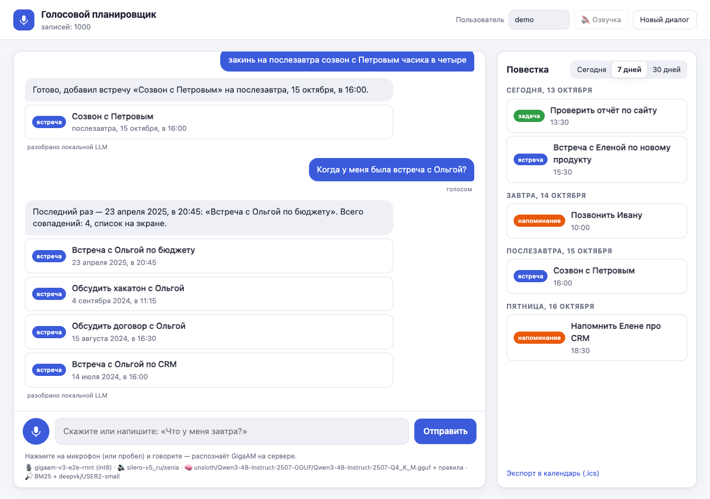
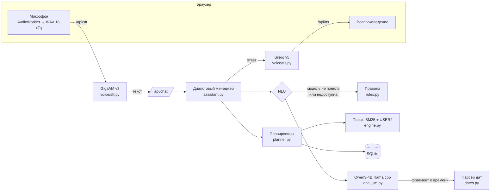

# Голосовой планировщик

Прототип голосового ассистента для задач, напоминаний и встреч. Пользователь говорит или пишет в свободной форме: «Напомни мне завтра в 10 утра позвонить Ивану», «Что у меня на этой неделе?», «Когда у меня была встреча с Иваном?». Ассистент понимает запрос, выполняет действие, отвечает текстом и голосом и переспрашивает, если чего-то не хватает.

Все модели — бесплатные и открытые, с Hugging Face. Они работают локально, без платных API: распознавание речи — GigaAM v3, синтез — Silero v5, понимание фраз — Qwen3-4B через llama.cpp, смысловой поиск — USER2. Без моделей приложение тоже работает: фразы разбирают правила, голос обрабатывает браузер.



**Рабочий прототип:** _ссылка появится после деплоя (см. раздел «Развёртывание»)._

## Что умеет

| Сценарий | Примеры фраз | Что происходит |
|---|---|---|
| Задача / напоминание | «Напомни мне завтра в 10 утра позвонить Ивану», «В пятницу нужно отправить отчёт», «Поставь задачу купить билеты до конца недели» | Определяет тип, содержание, дату и время или срок «до», сохраняет запись и подтверждает |
| Встреча | «Добавь встречу с командой завтра в 15:00», «В четверг в 11 у меня встреча с дизайнером», «закинь на послезавтра созвон с Петровым часика в четыре» | Сохраняет встречу (60 минут по умолчанию) и проверяет пересечения с другими встречами |
| Записи за период | «Что у меня сегодня?», «Какие планы на сегодня?», «Покажи мои встречи на сегодня», «мои дела на эту неделю», «Что было в прошлом месяце?» | Показывает записи за период (с повторяющимися), озвучивает первые несколько |
| Поиск | «Найди задачу про презентацию», «Когда у меня была встреча с Иваном?», «Я когда-то ставил задачу по договору, найди её» | Ищет по смыслу: не важны падежи, синонимы, опечатки распознавания; «финансы» находят «бюджет» и «смету» |
| Уточнения | «Поставь встречу с Иваном завтра» → «На какое время поставить встречу?» → «в 15:00» | Спрашивает недостающее, предлагает другое время при пересечении, уточняет, какую запись из нескольких имели в виду. После голосового вопроса сам включает микрофон для ответа |
| Изменение | «Перенеси её на пятницу», «Сдвинь созвон на час позже», «Отложи задачу про отчёт на неделю», «Переименуй задачу про отчёт в отчёт за квартал» | Понимает ссылки на предыдущий ответ («её», «эту», «вторую») |
| Удаление, выполнение | «Удали задачу про отчёт» → «вторую» → «да», «готово, отчёт отправил» | Перед удалением спрашивает подтверждение |
| Повторы | «Каждый понедельник в 10 планёрка», «По будням в 9 стендап» | Повторяющиеся записи разворачиваются в повестке |

Относительные даты: «сегодня», «завтра», «послезавтра», «в пятницу», «в следующую среду», «на следующей неделе в среду», «через два часа», «через полчаса», «до конца месяца», «в выходные», «15 октября», «15.10», «в половине третьего», «вечером», «в пятнадцать тридцать».

## Голосовой ввод

**Диктовка — основной режим.** Нажмите 🎤 (или пробел вне поля ввода). Строка ввода сменяется панелью записи: полоски громкости, таймер и три кнопки.

- **✓ «Готово»** (или Enter) — запись распознаётся, текст **вставляется в поле, но не отправляется**. Его можно поправить руками и отправить кнопкой «Отправить».
- **➤ «Отправить сразу»** — то же, но сообщение сразу уходит в чат с пометкой «голосом».
- **✕ «Отменить»** (или Esc) — запись выбрасывается и на сервер не отправляется; поле остаётся как было. Во время распознавания ✕ отменяет ожидание.

Пауза в речи запись не останавливает: закончить решаете вы. Если в поле уже есть текст, новый дописывается в конец, так что можно надиктовать фразу, поправить её руками и дописать голосом. Запись длится не дольше 20 секунд: за 5 секунд до конца таймер краснеет, а на 20-й секунде срабатывает «Готово» с подсказкой о лимите. Если сервер не смог распознать запись (нет сети, ошибка 5xx), она не теряется: в уведомлении есть кнопка «Повторить».

**Hands-free после голосового вопроса.** Если вы говорили голосом, а ассистент переспросил («На какое время поставить встречу?»), микрофон включается сам и показывает ту же панель с подписью «Слушаю ответ… замолчите, чтобы отправить». После паузы в 1,1 с ответ уходит сам. ✕ отменяет, ✓ отправляет сразу.

**Без серверного распознавания** (`STT_MODEL=off`) диктовку ведёт Web Speech API браузера: промежуточный текст виден прямо на панели, а вместо уровня громкости «дышат» полоски.

## Быстрый старт

Нужен Python 3.11+.

```bash
# с моделями (рекомендуется): при первом запуске скачается ~3 ГБ с Hugging Face
uv sync --extra ml
uv run uvicorn app.main:app

# лёгкий режим без моделей: правила и голос браузера
uv sync
uv run uvicorn app.main:app

# через pip
python -m venv .venv && source .venv/bin/activate
pip install -r requirements.txt
pip install -r requirements-ml.txt          # необязательно: модели
uvicorn app.main:app

# Docker (WITH_ML=0 — образ без моделей)
docker build -t voice-planner . && docker run -p 8000:8000 voice-planner
```

Откройте http://localhost:8000. Браузер попросит доступ к микрофону; по сети это работает только через HTTPS или на `localhost`. С серверным распознаванием голосовой ввод работает в любом современном браузере, включая Firefox. Внизу страницы видно, какие модели активны.

При первом запуске в базу импортируется `data/voice_assistant_events.csv` (1000 событий) для пользователя `demo`, а модели загружаются в фоне (около 15 секунд, если они уже скачаны). Модели настраиваются в `.env`, см. `.env.example`.

```bash
uv run pytest                                        # 188 тестов, модели не нужны
node --test tests/js/*.test.mjs                      # 6 тестов строки ввода (чистые функции, без сборки)
uv run python -m eval.run_nlu_eval --backend rules --backend hybrid:qwen3-4b-2507   # сравнение разборщиков
```

## Модели

| Задача | Модель | Почему она | Скорость (MacBook M5) |
|---|---|---|---|
| Распознавание речи | [GigaAM v3 e2e-RNNT](https://huggingface.co/ai-sage/GigaAM-v3) (Сбер, MIT), ONNX int8 через [onnx-asr](https://pypi.org/project/onnx-asr/) | Лучшая открытая модель для русского: средний WER 8,4% против 25% у Whisper large-v3 и 19% у T-one (таблица в карточке модели). Сразу выдаёт пунктуацию и цифры («завтра в 10:00»), которые понимает парсер дат. ONNX работает без PyTorch; int8-версия весит 225 МБ вместо 885 МБ и на проверочных фразах распознаёт так же | ~0,06 с на фразу, CPU |
| Синтез речи | [Silero TTS v5](https://github.com/snakers4/silero-models) `v5_ru`, голос xenia | Единственная русская модель с задержкой реального времени на CPU; сама ставит ударения и «ё», в том числе в омографах. ESpeech, F5-TTS и Qwen3-TTS звучат выразительнее, но на CPU синтезируют фразу от 4 до 130 секунд ([сравнение на Хабре](https://habr.com/ru/companies/raft/articles/991844/)) | 0,02–0,3 с на фразу, CPU |
| Понимание фраз | [Qwen3-4B-Instruct-2507](https://huggingface.co/unsloth/Qwen3-4B-Instruct-2507-GGUF) Q4_K_M (Apache-2.0) через llama.cpp | Лучшая точность на отложенном наборе фраз при вдвое меньшей задержке, чем у Qwen3.5-4B (сравнение ниже) | ~2 с на фразу (GPU Metal), 3–4,5 с на CPU |
| Смысловой поиск | [deepvk/USER2-small](https://huggingface.co/deepvk/USER2-small) (34M, Apache-2.0) | Русский энкодер предложений. На коротких названиях задач не уступает USER2-base и работает в 4 раза быстрее | ~4 мс на запрос |

Silero распознаёт только слова: цифры он молча пропускает («73 записи» превращались в «записи»). Поэтому перед озвучкой текст проходит нормализацию (`app/voice/speakable.py`): «14 октября 2027, в 10:00» → «четырнадцатого октября две тысячи двадцать седьмого года, в десять ноль-ноль», «1 встреча, 21 запись» → «одна встреча, двадцать одна запись». Нормализация проверена сквозным тестом: озвученные ответы ассистента распознаются GigaAM обратно без потерь в датах, времени и числах.

### Как выбиралась LLM

Кандидаты — модели, которые помещаются в 16 ГБ и отвечают за секунды: Qwen3-4B-Instruct-2507, Qwen3.5-4B и Qwen3.5-2B (февраль 2026), QVikhr-3-4B (Qwen3, дообученная на русском). Все — в квантовании Q4_K_M. Они сравнивались на наборе из 62 фраз (`eval/nlu_cases.jsonl`): фразы из ТЗ, перефразировки и разговорные формулировки вроде «закинь на послезавтра созвон с Петровым часика в четыре» и «готово, отчёт отправил». Для каждой фразы проверяются намерение, дата, время, период, тип и ключевые слова. Пост-обработку я дорабатывал, глядя на ошибки на этом наборе, поэтому итог проверен на отложенном наборе из 25 новых фраз (`eval/nlu_holdout.jsonl`), под который ничего не подстраивалось.

| Разборщик | Основной набор (62) | Отложенный набор (25) | Задержка, сред. / p90 |
|---|---|---|---|
| Только правила | 58 (94%) | 23 (92%) | <1 мс |
| **Qwen3-4B-Instruct-2507 + правила** | 61 (98%) | **25 (100%)** | 2,1 / 2,5 с |
| Qwen3.5-4B + правила | 62 (100%) | 24 (96%) | 4,1 / 4,6 с |
| QVikhr-3-4B + правила | 54 (87%) | — | 2,1 / 2,6 с |
| Qwen3.5-2B + правила | 52 (84%) | — | 2,8 / 3,2 с |

После доработки правил (разговорные запросы, неявное создание, «закинь… часика в четыре», поиск по типу) основной набор пополнен до 73 фраз. Правила: 70 из 73 (96%) на основном наборе и 24 из 25 (96%) на отложенном. Таблица выше снята на прежних 62 фразах, модели на расширенном наборе не перепрогонялись.

Выводы:

- **Модель не считает даты.** В первой версии LLM возвращала даты сама. Qwen3.5-2B тогда разбирала верно 31% фраз: «5 ноября» превращалось в 5 октября, «в понедельник» — в субботу. Теперь модель отвечает за язык (намерение, содержание, тему, «её/эту»), а время переписывает фрагментом фразы («в следующую среду в 13:00»). Точную дату из фрагмента вычисляет детерминированный парсер. Это подняло Qwen3.5-2B до 84%, а 4B-модели — до 98–100%. Без календаря в промпте ответ к тому же короче.
- **Qwen3.5 медленнее Qwen3 вдвое**, хотя размер тот же. У гибридной архитектуры (Gated DeltaNet + attention) llama.cpp не может переиспользовать кэш системного промпта, и он пересчитывается на каждой фразе.
- **Правила и модель дополняют друг друга.** Если модель ответила «не понял» или «помощь», а правила уверенно узнали команду, используются правила. Если модель не указала тип записи, он берётся из слов фразы («встречи», «задачи»). Если «поиск» без темы, это просмотр за период.
- **Сам прогон тоже выявил баг.** pymorphy3 приводит «демо» к бессмысленной форме «дть», из-за чего не срабатывал синоним «демо ≈ презентация». Добавлен словарь исключений.

Модель меняется переменной `LOCAL_LLM_MODEL` (`qwen3-4b-2507`, `qwen3.5-4b`, `qwen3.5-2b`, `qvikhr-3-4b`). Платный Claude остался как альтернативный бэкенд (`LLM_BACKEND=claude`) с тем же контрактом.

## Архитектура



Слои разделены, каждый знает только о соседнем:

- **Голос.** В браузере (`static/voice.js`) микрофон пишется через AudioWorklet, понижается до 16 кГц и упаковывается в WAV. Распознанный текст по умолчанию попадает в поле ввода, а не сразу в чат (см. «Голосовой ввод»); сама по себе, после 1,1 с тишины, запись останавливается только в hands-free. Чистые функции строки ввода вынесены в `static/input.js`. На сервере (`app/voice/`) — распознавание, синтез и нормализация текста для озвучки. Если серверных моделей нет, `voice.js` переключается на Web Speech API и speechSynthesis браузера.
- **NLU** (`app/nlu/`) превращает реплику в `ParsedCommand`. Это общий контракт: диалоговый менеджер не знает, кто разобрал фразу — правила, локальная LLM или Claude. Промпт и JSON-схема общие (`llm_prompt.py`). У локальной модели ответ ограничен грамматикой из JSON-схемы, поэтому даже маленькая модель всегда возвращает валидную структуру.
- **Диалог** (`app/services/assistant.py`) выполняет команду и ведёт состояние: чего ассистент ждёт (недостающие данные, подтверждение, выбор из списка) и о каких записях шла речь. Состояние хранится в БД и переживает перезапуск.
- **Бизнес-логика** (`app/services/planner.py`): создание, повестка с разворачиванием повторов, конфликты, напоминания к срабатыванию.
- **Поиск** (`app/search/`) и **хранение** (`app/storage/`: SQLite, миграции через `PRAGMA user_version`, импорт CSV).
- **Сборка** (`app/container.py`). Каждая модель создаётся, только если она включена и её пакеты установлены. При старте модели загружаются в фоне, и ошибка загрузки любой из них не роняет приложение.

```
app/
  core/        модели (Record, Occurrence, Period) и контракт ParsedCommand
  nlu/         text.py — токены и числительные; dates.py — даты и время; rules.py — правила;
               llm_prompt.py — промпт, схема, пост-обработка; local_llm.py — llama.cpp; claude.py; service.py
  voice/       stt.py — GigaAM; tts.py — Silero; speakable.py, numerals.py — текст для озвучки; audio.py — WAV
  search/      morph.py — леммы; synonyms.py; semantic.py — эмбеддинги; engine.py — ранжирование
  services/    assistant.py — диалог; planner.py; phrases.py — русские формулировки; ics.py
  storage/     db.py; repository.py; importer.py + cleaning.py — импорт CSV
  api/         routes.py, schemas.py
static/        index.html, app.js, voice.js, input.js, styles.css
eval/          наборы фраз и скрипт сравнения разборщиков
tests/         188 тестов: даты, правила, поиск, импорт, диалоги, API, LLM и голос с подменёнными моделями;
               tests/js — тесты строки ввода для node --test
```

## Технологии

| Что | Выбор | Почему |
|---|---|---|
| Сервер | Python 3.12, FastAPI | Лучшие библиотеки для русской морфологии и локальных моделей; валидация запросов через Pydantic |
| Запуск LLM | llama-cpp-python (GGUF, Metal/CPU) | Работает и на Mac (GPU), и на обычном сервере (CPU); грамматики из JSON-схемы; один файл модели вместо PyTorch-окружения |
| Запуск STT | onnx-asr + onnxruntime | Без PyTorch, быстро на CPU |
| Морфология | pymorphy3 | Леммы для поиска, исправление падежей в данных, согласование числительных при озвучке |
| Поиск | BM25 по леммам + синонимы + rapidfuzz + эмбеддинги | Слова дают точность, эмбеддинги — смысл; всё локально, миллисекунды на тысячу записей |
| База | SQLite | Ничего не нужно поднимать; для прототипа с одним процессом достаточно |
| Интерфейс | HTML и JS без сборки | По ТЗ акцент на логике. Есть тёмная тема и мобильная вёрстка |

## Как понимается запрос

**LLM** (`app/nlu/llm_prompt.py`, `local_llm.py`). Модель получает компактный системный промпт с шестью примерами и реплику. Если ассистент только что задал вопрос или показал список, она получает и этот контекст. Возвращает JSON: намерение, содержание (`title`), фрагмент о времени (`when`), описание изменяемой записи (`target`), тему поиска (`query`), типы, направление во времени, признак ссылки «её/эту», номер варианта. Даты из `when` и `target` вычисляет `WhenExtractor`, дальше идёт пост-обработка, описанная выше.

**Правила** (`app/nlu/rules.py`, `dates.py`) работают без моделей и служат запасным путём:

1. Реплика разбивается на токены, у каждого — исходная форма (для названия записи) и нормализованная: нижний регистр, «ё» → «е», «двадцать первого» → `21`.
2. `WhenExtractor` применяет 37 правил: относительные дни, дни недели, «через N часов», даты, периоды, время с «утра/дня/вечера», «в половине третьего», интервалы, длительность, сдвиги, повторы. Найденный фрагмент закрашивается, чтобы его не разобрало следующее правило.
3. Намерение определяется по словам-триггерам; если их несколько, побеждает самый ранний: «Поставь задачу удалить файлы» — создание, «Удали задачу про отчёт» — удаление.
4. Просмотр или поиск решает наличие темы: «Что у меня сегодня?», «Какие планы на сегодня?» и «Покажи мои встречи на сегодня» дают одно действие.
5. Остаток фразы после команды и даты становится названием записи.

**Уточняющий диалог.** Если не хватает данных, ассистент спрашивает и ждёт ответа; новая команда вместо ответа отменяет вопрос. Фраза со своим содержанием («Каждый понедельник в 10 планёрка» в ответ на «На какое время?») — тоже новая команда, а не ответ. Если запись угадана без явной просьбы и название не похоже на дело («завтра Петров»), ассистент сначала спрашивает: «Создать задачу «Петров» на завтра?». Вопрос со знаком «?» без «добавь/поставь» считается запросом, а не созданием. Встречи проверяются на пересечения. Если время на сегодня уже прошло, ассистент предлагает завтра. Если под описание подходят несколько записей, он предлагает выбрать номер.

## Поиск

`app/search/engine.py`. Каждое слово запроса приводится к начальной форме и расширяется синонимами (`созвон` ≈ `позвонить`, `договор` ≈ `контракт`, `Иван` ≈ `Ваня`, `ТЗ` = `техническое задание`), нечёткими совпадениями (`презинтация` → `презентация`) и совпадением по началу слова. Для каждого слова берётся лучшее из расширений (BM25), сумма умножается на долю покрытых слов.

К нормированной оценке добавляется смысловое сходство из USER2-small. Косинусы эмбеддингов сжаты (медиана по коллекции около 0,7), поэтому сигналом считается превышение над медианой. Так «финансы» находят «бюджет» и «смету», а запрос без смысловой связи (например, «поход в кино») ничего лишнего не добавляет. Векторы названий кэшируются: 1000 записей — это около 380 уникальных названий. Результаты группируются по релевантности, внутри группы сортируются по дате: для «была» — сначала недавние, для «будет» — ближайшие.

## Данные

Исходный CSV содержит только `id, date, time, text`. При импорте (`app/storage/importer.py`, `cleaning.py`):

- **Тип выводится из начала текста.** «Встреча…», «Созвон…», «Демо…», «Провести планёрку…», «Обсудить…» — встреча; «Напомнить…» — напоминание; остальное — задача. «Подготовиться к встрече с Вектором» остаётся задачей. Итог: 672 задачи, 275 встреч, 53 напоминания.
- **Исправляются падежи.** Тексты сгенерированы по шаблонам с ошибками: «Позвонить Иваном», «Напомнить Ольгой про сайту», «Обсудить договору с Сергеем». Ассистент зачитывает названия вслух, поэтому они исправляются через pymorphy3: «Позвонить Ивану», «Напомнить Ольге про сайт», «Обсудить договор с Сергеем». Исходный текст сохраняется в `original_text`.
- Импорт идемпотентен. Некорректные строки попадают в отчёт с номером строки.

## Дополнительные возможности из ТЗ

- [x] Изменение и удаление голосом (с подтверждением удаления)
- [x] Отметка задачи выполненной
- [x] Обработка конфликтующих встреч (предложение выбрать другое время)
- [x] Повторяющиеся задачи и встречи
- [x] Контекст диалога («А перенеси её на завтра», «удали вторую»)
- [x] Семантический поиск (эмбеддинги USER2 + морфология, синонимы, опечатки)
- [~] Интеграция с календарём: экспорт и подписка `.ics`; двусторонней синхронизации нет
- [x] Несколько пользователей (данные и диалоги разделены по `user_id`; авторизации нет)
- [x] Неоднозначные запросы и уточняющий диалог
- [x] Напоминания срабатывают: страница раз в 30 секунд проверяет наступившие, показывает уведомление и озвучивает его

## API

| Метод | Путь | Назначение |
|---|---|---|
| POST | `/api/chat` | `{text, session_id, user_id, timezone}` → `{text, summary, speech, items, awaiting, intent, nlu}` |
| POST | `/api/stt` | WAV (PCM 16 бит, моно, до 25 с) → `{text}` |
| POST | `/api/tts` | `{text}` → WAV |
| GET | `/api/agenda?start=&end=` | Записи за период (с повторами) и задачи без срока |
| GET | `/api/search?q=` | Поиск без диалога |
| GET | `/api/reminders/due?since=` | Наступившие напоминания |
| GET | `/api/calendar.ics` | Экспорт в iCalendar |
| GET | `/api/health` | Активные модели, число записей |

Документация OpenAPI — по адресу `/docs`.

## Решения, принятые самостоятельно

- LLM понимает язык, а даты считает код: так точнее (см. «Как выбиралась LLM») и проще тестировать.
- Модели загружаются при старте в фоне. Если какая-то недоступна, работает запасной вариант, а не ошибка.
- «В пятницу», сказанное в пятницу, означает следующую пятницу. «В эту пятницу» — пятница текущей недели.
- Час без уточнения от 1 до 7 считается дневным: «в 3» = 15:00. «Утром» = 09:00, «днём» = 13:00, «вечером» = 19:00.
- Время без даты — ближайшее: сегодня, если ещё не прошло, иначе завтра.
- «До конца недели» — срок в воскресенье; «на следующей неделе» для задачи — срок в конце той недели. «Отложи на неделю» — сдвиг от текущей даты записи.
- Задаче не обязательны дата и время. Встрече и напоминанию время обязательно, иначе ассистент спрашивает.
- Встреча по умолчанию длится 60 минут; изменение повторяющейся записи применяется ко всей серии.
- Время хранится «настенное», в часовом поясе пользователя; браузер передаёт свой часовой пояс.
- Импортированные записи получают статус «не выполнено»: в данных статуса нет.
- Пользователь определяется по имени без пароля — этого достаточно, чтобы показать разделение данных.
- Надиктованный текст по кнопке ✓ попадает в поле, а не сразу в чат: распознавание иногда ошибается, и фразу удобно поправить перед отправкой. Сразу отправляет только ➤.
- Микрофон сам включается для ответа на уточняющий вопрос, только если предыдущее сообщение ушло голосом (➤ или hands-free). Если текст правили в поле, диалог дальше идёт текстом.
- Если запись угадана без явной команды и название не похоже на дело, ассистент сначала переспрашивает: лишний вопрос лучше мусорной задачи в списке.

## Ограничения

- **Лицензия Silero** разрешает бесплатное использование только в некоммерческих целях. Веса скачиваются пакетом `silero` с серверов Silero, а не с Hugging Face. Для коммерческого продукта стоит взять ESpeech-TTS (Apache-2.0, на Hugging Face) и запускать его на GPU.
- **LLM без GPU медленная.** На CPU Mac M5 — 3–4,5 с на фразу, на облачном сервере с 2 vCPU будет заметно дольше. Там разумно выключить LLM (`LLM_BACKEND=off`): правила дают около 96% на наших наборах, а распознавание, синтез и эмбеддинги быстрые и на CPU.
- **Наборы фраз небольшие** (73 + 25). Это сравнение моделей между собой, а не оценка качества в продакшене.
- На бесплатном тарифе Render диск временный: после перезапуска база создаётся заново из CSV, а модели скачиваются снова.

## Что улучшить при наличии времени

1. **Расширить наборы фраз до нескольких сотен**, в том числе реальные записи голоса, и сравнивать на них правила и модели при каждом изменении.
2. **Дообучить маленькую модель (LoRA на Qwen3.5-2B) под нашу схему.** Задержка снизится до долей секунды, и на CPU тоже.
3. **Потоковое распознавание** (T-one или GigaAM с VAD на сервере): текст появляется во время речи.
4. **Синхронизация с Google Calendar или CalDAV** в обе стороны вместо экспорта.
5. **Push-уведомления и Telegram-бот** для напоминаний при закрытой вкладке.
6. **Исключения в повторах** («перенеси только эту планёрку») и отмена последнего действия.
7. **PostgreSQL + pgvector, авторизация, отдельный процесс для напоминаний** — для нескольких экземпляров.

## Развёртывание

В репозитории есть `Dockerfile` (`WITH_ML=1` — с моделями, `0` — лёгкий образ) и `render.yaml`. Порт задаётся переменной `PORT`, проверка работоспособности — `/api/health`. Для образа с моделями нужна машина с 8+ ГБ памяти. Подойдут, например, Hugging Face Spaces (Docker, бесплатный CPU с 16 ГБ) или VPS. На бесплатном Render лучше собирать лёгкий образ.

Проверка лёгкого образа локально:

```bash
docker build --build-arg WITH_ML=0 -t voice-planner .
docker run -p 8000:8000 voice-planner
curl http://localhost:8000/api/health        # {"status":"ok","nlu":"rules",...}
```

Деплой на Render (лёгкий образ: без моделей, `LLM_BACKEND=off`):

1. Войти на [render.com](https://render.com) и подключить GitHub-аккаунт с доступом к репозиторию.
2. **New → Blueprint**, выбрать репозиторий и ветку `main`. Render прочитает `render.yaml`.
3. Проверить, что у сервиса `voice-planner` заданы переменные `WITH_ML=0`, `LLM_BACKEND=off`, `STT_MODEL=off`, `TTS_SPEAKER=off`, `EMBEDDINGS_MODEL=off`. Render передаёт переменные окружения в `docker build` как build args, поэтому `WITH_ML=0` собирает лёгкий образ.
4. **Apply** и дождаться сборки. Health check `/api/health` должен стать зелёным.
5. Открыть выданный адрес `https://<имя>.onrender.com`. Микрофон работает, потому что Render отдаёт сайт по HTTPS. Распознавание в лёгком образе — браузерное (Chrome/Edge), в Firefox доступен только текстовый ввод.
6. Вставить адрес в начало README вместо плейсхолдера: **Рабочий прототип:** `<ссылка>`.

Бесплатный сервис засыпает после 15 минут без запросов, и первый запрос после этого идёт около минуты.
